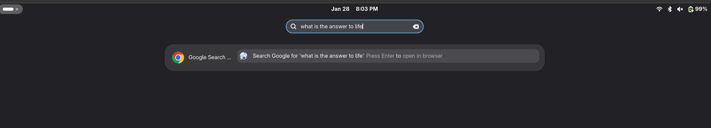

# GNOME Web Search Provider

A GNOME Shell search provider that lets you search the web directly from the
Activities Overview (the `Super` key search box), choosing **one or more
search destinations at the same time** — from Google and DuckDuckGo to
Perplexity, ChatGPT, Claude and Grok. The catalog contains **56 built-in
providers**, plus custom URL templates.

Every enabled provider shows its own result entry in the overview
("Search Google for 'linux'", "Search Bing for 'linux'", ...). Press Enter to
open the chosen destination in your configured browser. This is a **GNOME
Activities Overview integration**, not a browser address-bar extension or an
AI API client. Queries are encoded into URLs; the destination handles the
search or chat using your browser session.

[Website and installation guide](https://zonaro.github.io/gnome-web-search-provider/)
· [Issue board](https://github.com/users/zonaro/projects/12)



## Features

- 56 built-in providers, grouped by category (web, images, maps, videos,
  news, communities, media, reference/docs) — plus your own **custom
  providers** from any website.
- Enable **up to 5 providers simultaneously** — they all appear as separate
  entries in the search overview. This is a GNOME Shell limit: the overview
  renders at most 5 results per provider (see
  [Known limitation](#known-limitation)).
- **Google is the only provider enabled by default.**
- Customize **which web browser** opens the results (default: your system
  browser via `xdg-open`) — useful for flatpaks, alternate browsers or
  custom launchers.
- Preferences window (`gnome-web-search-provider-config`) with an icon grid per
  provider (real site favicons with symbolic icons as fallback, name + switch,
  with search filter); changes apply immediately, no reload needed.
- Command-line client (`gnome-web-search-provider-cli`) to manage providers
  and the browser from the terminal.
- Native GNOME configuration via a **GSettings schema**
  (`org.gnome.WebSearch.SearchProvider`), so it can also be scripted with
  `gsettings`, with a transparent JSON fallback
  (`~/.config/gnome-web-search-provider/config.json`) when the schema is not
  installed.
- **Standard-library-only daemon and CLI**: no pip-installed dependencies.
  GNOME Shell integration requires GNOME; the preferences window also needs
  GTK4 and PyGObject.
- Preferences and result labels support **English, Brazilian Portuguese and
  Spanish**, with language detection and English fallback.
- URL templates include Google's `udm=` verticals and AI destinations.
  External services can change their URL behavior independently of this app.

## Known limitation

The overview shows **at most 5 results per search provider**. That constant is
hardcoded in GNOME Shell (`MAX_LIST_SEARCH_RESULTS_ROWS = 5` in
`js/ui/search.js`, enforced by `RemoteSearchProvider.filterResults()` in
`js/ui/remoteSearch.js`), and no GSettings key changes it; extra results are
only summarized as "N more" on the provider header.

This provider shows one entry per enabled engine, so enabling more than 5
engines has no effect beyond the first five. To make that explicit, the
preferences window, the CLI and the daemon all cap the enabled list at
**5 providers** — the sixth toggle is refused with a message instead of being
silently ignored.

## Available providers

| Category | Providers |
|---|---|
| **Web Search** | Google (default), Bing, DuckDuckGo, Brave Search, Startpage, Ecosia, Qwant, Yahoo, Mojeek, Yandex, Baidu, Naver, SearXNG, Yep (Ahrefs), Swisscows, Marginalia, Perplexity, Kagi, You.com, ChatGPT Search, Claude, Grok, Microsoft Copilot Search |
| **Images** | Google Images, Bing Images, DuckDuckGo Images, Brave Images, Startpage Images |
| **Maps** | Google Maps, Bing Maps, OpenStreetMap |
| **Google Services** | Google News, Google Scholar, Google Videos, Google Translate (→ pt), Google Flights, Google Fonts |
| **Communities** | Reddit, Hacker News, GitHub, Stack Overflow |
| **Media** | YouTube, YouTube Music, Spotify, Deezer, Tidal, IMDb, Steam |
| **Reference & Tech** | Wikipedia, Wiktionary, WolframAlpha, PyPI, MDN Web Docs, Docker Hub, Internet Archive, Arch Wiki |

Kagi requires an account; other services may also require sign-in, accept
terms, impose usage limits or restrict availability by region.

### AI search and chat destinations

Perplexity and You.com were already included. The catalog now also contains:

| Provider ID | Display name | URL template |
|---|---|---|
| `chatgpt` | ChatGPT Search | `https://chatgpt.com/?q={query}` |
| `claude` | Claude | `https://claude.ai/new?q={query}` |
| `grok` | Grok | `https://grok.com/?q={query}` |
| `copilot` | Microsoft Copilot Search | `https://www.bing.com/search?q={query}&copilot=on` |

These are browser URL templates, **not API integrations**. Depending on the
service and your signed-in session, a URL may prefill a prompt, require manual
submission or open standard search. The display name does not guarantee that
web-search mode is selected. URL encoding is covered by automated tests;
end-to-end prompt submission and forced AI search for these four templates
have **not been verified**. No API key is needed by this application.

For example, after installation:

```bash
gnome-web-search-provider-cli set google perplexity chatgpt
```

Press `Super`, type a query, then choose the destination. This replaces the
enabled set but does not change your browser's default search engine.

### Privacy and network requests

Activating a result opens a URL containing your query in the browser, which
sends it to the selected service under that service's privacy policy. Settings
are stored locally. The installer and preferences app can also download site
favicons; fallback icon requests may contact Google or DuckDuckGo and include
the provider's domain (not your search query).

## Requirements

- GNOME Shell (search providers need GNOME; the preferences app needs GTK4)
- Python 3.8+
- The **provider daemon has zero runtime dependencies** — pure Python
  standard library. Only `glib-compile-schemas` is needed at install time
  (part of `glib2`/`libglib2.0-bin`).
- The preferences **window** additionally needs `PyGObject` with GTK4
  bindings (`gi`); without it the daemon and CLI still work, and the window
  prints a friendly message instead of crashing.
- libadwaita is optional for native theme integration; the preferences window
  falls back to GTK4 when it is unavailable.

**Fedora:**
```bash
sudo dnf install glib2-devel        # glib-compile-schemas (install only)
# optional, for the preferences window:
sudo dnf install python3-gobject gtk4 gobject-introspection-devel
```

**Ubuntu/Debian:**
```bash
sudo apt install libglib2.0-bin      # glib-compile-schemas (install only)
# optional, for the preferences window:
sudo apt install python3-gi gir1.2-gtk-4.0 libgirepository1.0-dev
```

## Installation

### Quick install from GitHub

On a GNOME desktop with the requirements above installed:

```bash
curl -fsSL https://raw.githubusercontent.com/zonaro/gnome-web-search-provider/master/install.sh | sh
```

This downloads the source and runs `install-local.sh`. Review remote scripts
before executing them. Most files are installed into `~/.local`, but **sudo is
required** to register the search-provider manifest in `/usr/local/share`.
Run it in a terminal where you can authenticate. Log out and back in afterward
so GNOME Shell discovers the provider. Re-run the installer to update; it does
not intentionally remove your settings or custom providers.

### System-wide Python installation

Install the Python package system-wide (the desktop/service files expect the
binaries in `/usr/local/bin`):

```bash
sudo pip install .
```

Register the GSettings schema so the provider and the preferences window can
use it (and pick up the desktop file):

```bash
sudo glib-compile-schemas /usr/local/share/glib-2.0/schemas/
sudo update-desktop-database /usr/local/share/applications/
```

### Install from a local checkout (no pip)

`install-local.sh` copies the package, launchers, schema, desktop files and
D-Bus service into `~/.local`:

```bash
sh install-local.sh
```

The script also uses sudo for the system search-provider manifest; it is not
entirely root-free. Run it from the repository root.

### Uninstall

Remove the package, launchers, GSettings schema, desktop entries, D-Bus
service and the provider manifest from both `~/.local` and `/usr/local`:

```bash
sh uninstall.sh
```

Remote one-liner:

```bash
curl -fsSL https://raw.githubusercontent.com/zonaro/gnome-web-search-provider/master/uninstall.sh | sh
```

Purge form (also deletes custom providers, settings and the favicon cache):

```bash
sh uninstall.sh --purge
```

Remote purge:

```bash
curl -fsSL https://raw.githubusercontent.com/zonaro/gnome-web-search-provider/master/uninstall.sh | sh -s -- --purge
```

User config (`~/.config/gnome-web-search-provider/`) and cache
(`~/.cache/gnome-web-search-provider/`) are kept unless `--purge` is used.
Log out and back in so GNOME Shell forgets the provider.

If installed system-wide with `sudo pip install .`, remove the Python package
with:

```bash
sudo pip uninstall gnome-web-search-provider
```

### Activate the provider

1. Log out and back in (or restart GNOME Shell) so the D-Bus service file and
   the search provider are discovered automatically.
2. GNOME Shell discovers the provider via
   `/usr/local/share/gnome-shell/search-providers/org.gnome.WebSearch.SearchProvider.ini`
   (`sh install-local.sh` copies it there with sudo — required because the
   Shell and gnome-control-center only scan system data dirs for
   search-providers, not `~/.local/share`) and autostarts it on demand.
   Opening **Settings > Search** re-scans on every open, so the entry can
   show up without a relogin; overview search picks it up after the Shell
   reloads providers (app install/update) or after logout/login. Toggle it
   in **Settings > Search** if needed.
3. Only **Provedores de Busca Web** (the config app) appears in the app grid.
   There is intentionally no separate provider launcher: GNOME Shell
   ignores search providers whose desktop entry doesn't `should_show()`
   (e.g. `NoDisplay=true`), so the `.ini`'s `DesktopId` points at the
   visible config desktop instead. If you still see a dead
   **Web Search Provider** app, it is a stale file from an older install —
   delete `~/.local/share/applications/org.gnome.WebSearch.SearchProvider.desktop`
   and `/usr/local/share/applications/org.gnome.WebSearch.SearchProvider.desktop`
   (or re-run `sh install-local.sh`, which removes them) and run
   `update-desktop-database`.
4. If the provider is missing from Settings > Search, check:
   `gsettings get org.gnome.desktop.search-providers disabled` — if our
   BusName is listed there, run
   `gsettings reset org.gnome.desktop.search-providers disabled` and log
   out/in again.

## Configuration

### Preferences window (recommended)

Launch **Web Search Providers** from the app grid, or run:

```bash
gnome-web-search-provider-config
```

Tick the providers you want — each one becomes an entry in the overview
search. "None" clears the selection. GNOME Shell displays at most 5
providers at a time, so the window caps the selection at 5 (turning on a
sixth is refused with a hint). Changes are written immediately.

### CLI

The `gnome-web-search-provider-cli` command manages providers and the
browser from the terminal (works with or without the GSettings schema):

```bash
# Show provider status
gnome-web-search-provider-cli list
gnome-web-search-provider-cli status google

# Enable/disable providers
gnome-web-search-provider-cli enable google duckduckgo
gnome-web-search-provider-cli disable duckduckgo

# Replace the enabled set (unknown ids are rejected)
gnome-web-search-provider-cli set google bing startpage

# Show / set the browser used to open results
gnome-web-search-provider-cli browser
gnome-web-search-provider-cli browser "flatpak run org.mozilla.firefox"
```

The same setting is available via `gsettings` when the schema is installed:

```bash
# Show current providers
gsettings get org.gnome.WebSearch.SearchProvider enabled-providers

# Enable Google + DuckDuckGo
gsettings set org.gnome.WebSearch.SearchProvider enabled-providers "['google', 'duckduckgo']"

# Restore the default (only Google)
gsettings reset org.gnome.WebSearch.SearchProvider enabled-providers

# Show / set the browser
gsettings get org.gnome.WebSearch.SearchProvider browser
gsettings set org.gnome.WebSearch.SearchProvider browser "firefox"
```

Valid provider ids are the keys listed in `src/gnome_web_search_provider/providers.py`
(e.g. `google`, `bing`, `duckduckgo`, `brave`, `startpage`, `google-images`,
`google-maps`, `bing-images`, `youtube`, ...) plus your `custom-*` ids.
Unknown ids are rejected by the CLI and ignored by the preferences window.

### Custom providers

Any website with a search box can become a provider:

1. Search for something on the site and copy the results URL, e.g.
   `https://forum.example.com/search?q=linux`.
2. Replace your search term with `{query}`:
   `https://forum.example.com/search?q={query}`.
3. Open the preferences window and click **+ Adicionar** in the
   **Personalizados** section (or use the CLI below), paste the URL, give
   it a name — done. It appears in the overview exactly like the
   built-in providers.

If the term goes in the URL path (e.g. `https://site.com/busca/linux`),
tick the path option so spaces are encoded as `%20` instead of `+`
(auto-detected when `{query}` comes before any `?`).

Icons are fetched automatically from the site's favicon; you can also pick
a custom image file per provider. Custom providers are stored in
`~/.config/gnome-web-search-provider/custom_providers.json` and work with
both the GSettings and the JSON backends.

```bash
# Add / list / remove from the terminal
gnome-web-search-provider-cli custom add --name "Meu Fórum" --url "https://forum.example.com/search?q={query}"
gnome-web-search-provider-cli custom add --name "Wiki" --url "https://wiki.example.com/busca/{query}" --path
gnome-web-search-provider-cli custom add --name "Docs" --url "https://docs.example.com/?q={query}" --icon ~/imagens/docs.png
gnome-web-search-provider-cli custom list
gnome-web-search-provider-cli custom remove custom-meu-forum
```

### JSON fallback

Without the schema, settings live in
`~/.config/gnome-web-search-provider/config.json`:

```json
{ "enabled_providers": ["google", "bing"], "browser": "firefox" }
```

Missing/corrupt files fall back to `["google"]` and `xdg-open`. Set
`"enabled_providers": []` to disable all providers, or omit `"browser"` to
keep the system default.

## Development

```bash
git clone https://github.com/zonaro/gnome-web-search-provider.git
cd gnome-web-search-provider

# Run the test suite (no system install needed)
python3 -m unittest discover -s tests -v

# Run the provider in-place (no D-Bus registration issues in a terminal)
python3 -m gnome_web_search_provider   # needs src/ on PYTHONPATH

# Open the preferences window against the JSON fallback
PYTHONPATH=src python3 -m gnome_web_search_provider.config_app
```

Layout:

```
data/    GSettings schema, desktop entries, D-Bus service, shell .ini
src/     gnome_web_search_provider/ package (provider, providers registry,
         config manager, pure-stdlib D-Bus service, CLI, GTK4 preferences app)
tests/   unit tests
```

## Goals

* **P0** — Search the web from the GNOME Shell overview
* **P0** — Package as a real extension (pip + system data files)
* **P1** — Configuration UI to pick one or more search engines ✅
* **P1** — Integrate suggestions for partial search terms

## Non-Goals

* Update the Activities Overview search results UI elements

## License

MIT, see [LICENSE](LICENSE). Forked from
[quiquevr/gnome-web-search-provider](https://github.com/quiquevr/gnome-web-search-provider).
